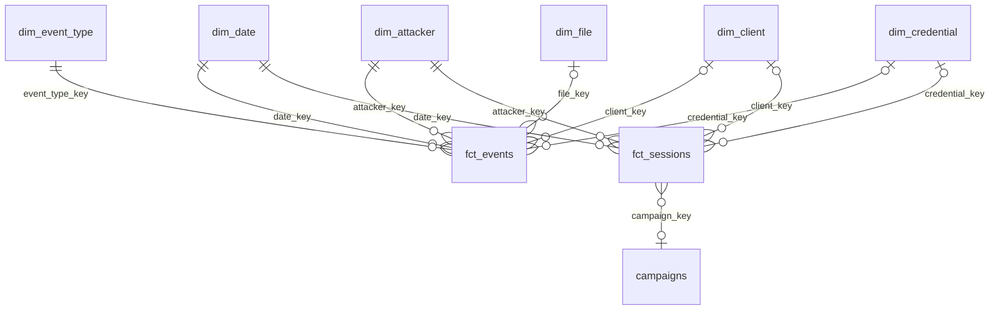

# Real-Time Honeypot Threat Intelligence Pipeline

A data pipeline that collects real attacks against an SSH honeypot ([Cowrie](https://github.com/cowrie/cowrie)), stores them in an S3 data lake and turns them into a dimensional model (galaxy schema) for threat intelligence analysis: who attacks, with which credentials, what commands they run, what malware they download and which attacks come from the same operator.

**In short:** over 41 days, the honeypot received **2.1 million events** from **275,392 sessions**, coming from **6,739 IP addresses**. 80% of the sessions that ran commands belong to **26 automated campaigns** (botnets), detected by the script they ran and the SSH tool they used.

## Contents

- [Dataset](#dataset)
- [Architecture](#architecture)
- [Data model: galaxy schema](#data-model-galaxy-schema)
- [Campaigns](#campaigns)
- [What you can do with the data](#what-you-can-do-with-the-data)
- [Future improvements](#future-improvements)
- [Tech stack](#tech-stack)
- [Project structure](#project-structure)
- [How to run](#how-to-run)
- [Status and next steps](#status-and-next-steps)

## Dataset

### Where the data comes from

Cowrie is a honeypot: a fake SSH/Telnet server, exposed to the internet, that simulates a Linux system. Every connection it receives is an attack or a scan, because the server has no real users. Cowrie accepts the login, gives the attacker a simulated shell and records everything: the connection, the SSH client, the passwords tried, the commands run, the files downloaded and the traffic sent through tunnels.

Every action becomes a JSON **event**, with a type (`eventid`) and a `session` that links all events of the same connection.


### What a typical session looks like

A session goes through the same steps, and every step produces one or more events:

```
connect ──► client.version / client.kex ──► login.success / login.failed ──► command.input ... ──► session.closed
            (which SSH program it uses)      (username + password)            (what it runs)
                                                                              file_download (what it downloads)
                                                                              direct-tcpip.* (uses the honeypot as a proxy)
```

| Category | Event types | Events |
|---|---|---:|
| session | `session.connect`, `session.closed`, `session.params`, `log.closed` | 1,031,962 |
| SSH client | `client.version`, `client.kex`, `client.fingerprint`, `client.size`, ... | 522,725 |
| login | `login.success`, `login.failed` | 253,122 |
| commands | `command.input`, `command.failed`, `command.success`, `command.chpasswd` | 244,145 |
| tunnel | `direct-tcpip.request`, `.data`, `.ja4`, `.ja4h` | 42,911 |
| files | `session.file_download`, `.file_upload`, `.file_download.failed` | 2,650 |

### What the data shows

- **Almost all attacks are automated.** The most frequently run command is `uname -s -v -n -r -m` (137,035 executions): the bot checks what kind of system it has landed on before deciding what to do next. The dominant SSH client is `SSH-2.0-Go`, meaning scripts written in Go, not people at a terminal.
- **Logins almost always succeed (99%)**, because that is how Cowrie is configured: it accepts any password, with a few exceptions. The exceptions are visible in the data: `root/123456` (1,361 attempts) and `root/root` (934) have 0 successes.
- **The credentials tried** are default or weak ones: `0/0`, `ubuntu/123456`, `ubuntu/ubuntu`, `admin/admin`, `root/12345678`. The pair `345gs5662d34/345gs5662d34` (1,650 attempts) is the signature of a known botnet.
- **Persistence through SSH keys.** The most widespread campaign deletes `~/.ssh` and writes the attacker's public key into `authorized_keys`, so it can come back without a password (see [Campaigns](#campaigns)).
- **The honeypot is used as a proxy.** 7,471 sessions opened `direct-tcpip` tunnels, most of them to Google IPs on port 80. Attackers check that the proxy works before using it.
- **Attacks come from the cloud, not from home computers.** Every attacker IP is enriched with its country and network (ASN) from [IPinfo Lite](https://ipinfo.io/lite). Up to 2026-10-18, the 7,391 IPs come from 142 countries and 1,988 networks, and the largest networks are hosting providers: Google Cloud (287 IPs), DigitalOcean (217), Microsoft Azure (196). The United States (1,116 IPs) and China (874) have the most attackers, but Germany has the most sessions (167,573 from 336 IPs).
- **One campaign, one hosting provider.** Almost all of those sessions come from 142 IPs of a single provider, BANATSYNC SRL (AS198364, in Germany and the Netherlands), all running the same `uname -s -v -n -r -m` script: 149,674 sessions, half of all sessions. The ASN confirms what the campaign detection suggested: those IPs belong to one operator.

## Architecture

```
 ┌── Hetzner VPS ──┐  cron   ┌──────────── S3 ────────────┐  Airflow  ┌──────── warehouse.duckdb ────────┐
 │ Cowrie          │ ──────► │ raw/    (json.gz, per day) │ ────────► │ bronze → silver → gold (dbt)     │
 │ SSH honeypot    │         │ bronze/ (Parquet, per day) │ ◄──────── │ fct_*, dim_*, campaigns          │
 └─────────────────┘         └────────────────────────────┘  DuckDB   │ enrichment.ipinfo ◄── IPinfo API │
                                                                      └──────────────────────────────────┘
  honeypot-sensor                                            honeypot-analyst
  (write-only to raw/)                                       (reads the lake, writes bronze/)
```

- **The sensor** is a Hetzner VPS running Cowrie, which uploads each day's logs to S3 every night.
- **The data lake** is a versioned S3 bucket with a `raw/` zone (untouched logs) and a `bronze/` zone (Parquet), both partitioned by day.
- **The analytics platform** (Airflow, DuckDB and dbt, running locally in Docker) converts raw → bronze directly in S3 and builds the warehouse in layers: bronze → silver → gold. Conversion and loading are incremental: only new days are processed.
- **Enrichment:** every new attacker IP is looked up once in the [IPinfo Lite](https://ipinfo.io/lite) API (country and ASN), and the result is cached in the warehouse.
- **Security:** each component has its own IAM user with minimal permissions. The keys on the sensor, the most exposed machine, can only upload files to `raw/`: they cannot read, list or delete anything.

Full diagram, bucket layout, IAM policies and server setup: [docs/documentation.md](docs/documentation.md#architecture).

## Data model: galaxy schema

The gold layer has **two fact tables** that share the same dimensions. A model with several fact tables sharing common dimensions (*conformed dimensions*) is called a **galaxy schema** (or *fact constellation*). It is the natural extension of a star schema: Kimball's rule is one fact table per grain, not a single fact table per model.



### Fact tables

| Table | Grain (one row =) | Rows | Questions it answers |
|---|---|---:|---|
| `fct_events` | one Cowrie event | 2,097,515 | which passwords are tried, which commands are run, which files are downloaded |
| `fct_sessions` | one session (connection) | 275,392 | how long an attack lasts, how many logins succeed, which script the attacker ran |

`fct_sessions` is an **aggregated fact table**: it is built from `fct_events`, not directly from the source. You could answer session questions from `fct_events`, but every query would have to redo a `group by session_id` over 2 million rows. Some measures don't even exist at event level, such as `command_sequence` (the ordered list of commands) or `login_success`. dbt tests check that the two tables agree: the sum of events across sessions equals the number of events.

### Dimensions

Each dimension has a surrogate key (`md5` of the natural key), so the same keys are computed identically in both fact tables.

| Dimension | One row = | Natural key | Rows |
|---|---|---|---:|
| `dim_date` | one day | date | 41 |
| `dim_event_type` | one event type | `event_type` | 23 |
| `dim_attacker` | one source IP | `src_ip` | 6,739 |
| `dim_client` | one SSH client | version + HASSH | 627 |
| `dim_credential` | one username/password pair | username + password | 85,238 |
| `dim_file` | one downloaded/uploaded file | SHA256 | 92 |

The keys `client_key`, `credential_key` and `file_key` are NULL on events unrelated to that dimension (for example, a `session.connect` has no credentials).

`dim_attacker` also carries the country and network of each IP (`country_code`, `country`, `continent`, `asn`, `as_name`, `as_domain`), joined from the enrichment table.

### `campaigns`

On top of `fct_sessions` sits `campaigns` (26 rows), an analysis table with one row per campaign. It is not a true dimension: `fct_sessions.campaign_key` exists for every session with commands (258 distinct signatures), but only signatures seen from at least 10 IPs make it into `campaigns`. The full explanation is in the next section.

All columns and design decisions: [docs/documentation.md](docs/documentation.md#data-model).

## Campaigns

### The problem

A botnet attacks from hundreds or thousands of IPs, which keep changing. If you only look at IPs, you see 6,739 independent attackers. In reality, most of them come from a handful of operators.

### The idea

Two things stay the same across all IPs of a botnet, because they come from the same code:

1. **The script**: the commands run in a session, in the same order.
2. **The tool**: the SSH program used to connect, identified by **HASSH**. When connecting, the SSH client sends the list of encryption algorithms it supports, in its own order. Every program (OpenSSH, PuTTY, `libssh`, Go's SSH library) has its own list, and HASSH is the hash of that list. Cowrie computes it automatically.

**A campaign = the same tool (HASSH) + the same script, seen from at least 10 different IPs.**

### How it is computed

```
fct_events ──► fct_sessions ──────────────────────────────────────► campaigns
               command_sequence      = "cd ~; chattr -ia .ssh ; ..."   group by campaign_key
               command_sequence_hash = md5(normalized commands)        having count(distinct IP) >= 10
               campaign_key          = md5(hassh | command_sequence_hash)
```

Before hashing, commands are **normalized**: digits and long hex strings become `N`. Some scripts put random values in their commands (new passwords, file names), and without normalization every run would look like a different script.

The 10-IP threshold is configurable (the `campaign_min_ips` parameter, see [docs/documentation.md](docs/documentation.md#parameters)).

### Results

26 campaigns, from 3,007 IPs, covering 187,980 sessions (80% of the sessions with commands). The largest ones, by number of IPs:

| What the script does | IPs | Sessions | Active days |
|---|---:|---:|---:|
| **SSH key implant** (`mdrfckr`): deletes `~/.ssh`, writes the attacker's key into `authorized_keys`, locks the file | 1,052 | 1,529 | 41 |
| Reconnaissance: `uname -a 2>/dev/null` | 946 | 8,343 | 6 |
| Reconnaissance: `uname -a 2>/dev/null`, different SSH tool | 660 | 21,359 | 13 |
| Reconnaissance: `uname -s -v -n -r -m` | 131 | 136,938 | 39 |
| SSH key implant, same script, different SSH tool | 73 | 136 | 37 |
| MikroTik router reconnaissance + hunting for competing miners (`/ip cloud print`, `ps \| grep '[Mm]iner'`, ...) | 32 | 37 | 24 |

A few observations:

- **The `mdrfckr` implant** is active every single day of the collection period. It runs from 1,052 IPs, but always with the same public key, so it is a single operator. The `authorized_keys` file created by the script is recorded by Cowrie as a `file_download` and always has the same hash.
- **The same script with different tools** shows up as two campaigns (rows 1 and 5). These may be different versions of the same bot, or operators who copied the script.
- **The sessions / IPs ratio** reveals behavior: the `uname -s -v -n -r -m` campaign has 131 IPs but 136,938 sessions, meaning each IP comes back more than 1,000 times. The key implant comes once or twice from each IP.

Method limitations and all `campaigns` columns: [docs/documentation.md](docs/documentation.md#campaigns).

## What you can do with the data

Each question below is a ready-to-run query in [`analysis/queries/`](analysis/queries/):

| Question | Query |
|---|---|
| What are the largest campaigns? | [`01_top_campaigns.sql`](analysis/queries/01_top_campaigns.sql) |
| Which IPs does a campaign attack from? | [`02_campaign_ips.sql`](analysis/queries/02_campaign_ips.sql) |
| Which passwords do attackers try? Useful as a banned-password list for your own infrastructure. | [`03_top_credentials.sql`](analysis/queries/03_top_credentials.sql) |
| Which commands do they run? | [`04_top_commands.sql`](analysis/queries/04_top_commands.sql) |
| What malware do they download? The SHA256 hashes can be looked up on [VirusTotal](https://www.virustotal.com) or [MalwareBazaar](https://bazaar.abuse.ch). | [`05_malware_files.sql`](analysis/queries/05_malware_files.sql) |
| How do attacks evolve over time? | [`06_sessions_over_time.sql`](analysis/queries/06_sessions_over_time.sql) |
| What kind of activity happens each day? | [`07_activity_by_category.sql`](analysis/queries/07_activity_by_category.sql) |
| Who uses the honeypot as a proxy, and to reach what? | [`08_proxy_destinations.sql`](analysis/queries/08_proxy_destinations.sql) |
| Which SSH tools do attackers use? | [`09_ssh_tools.sql`](analysis/queries/09_ssh_tools.sql) |
| Which countries do the attacks come from? | [`10_attackers_by_country.sql`](analysis/queries/10_attackers_by_country.sql) |
| Which networks (hosting providers, ISPs) do they come from? | [`11_attacker_networks.sql`](analysis/queries/11_attacker_networks.sql) |

Run one from the project root:

```bash
duckdb -readonly warehouse.duckdb -f analysis/queries/01_top_campaigns.sql
```

Or open them in the DuckDB UI (`duckdb warehouse.duckdb -ui`) and run them there.

## Future improvements

| Idea | What it adds | How |
|---|---|---|
| **Command classification** | what attackers are after: reconnaissance, persistence, download, mining | a `dim_command` with text rules, mapped to [MITRE ATT&CK](https://attack.mitre.org) tactics |
| **Blocklist** | a daily exported list of IPs to block | IPs of campaigns active in the last N days, written to S3 by an Airflow task |
| **New-campaign alert** | know when a new script shows up | a dbt test or a task that compares `campaigns` with the previous day |
| **More IP sources** | whether an IP is already reported for abuse, and since when | a new `Enricher` subclass for [AbuseIPDB](https://www.abuseipdb.com), added to `enrichment/` |
| **File enrichment** | the malware family (Mirai, XMRig, ...) | SHA256 lookup in the VirusTotal or MalwareBazaar API |
| **Dashboard** | visualization for people who don't write SQL | Evidence, Metabase or Superset on top of `gold` |

## Tech stack

- **Cowrie**: SSH/Telnet honeypot, running in Docker (`infra/honeypot/`)
- **AWS S3 + IAM**: data lake (raw and bronze zones), with one IAM user for the sensor and one for the analytics platform
- **Apache Airflow 3.3**: orchestration (`dags/honeypot_dag.py`)
- **DuckDB 1.5**: JSON → Parquet conversion directly in S3, and the local data warehouse
- **dbt (dbt-duckdb)**: transformations, tests and the dimensional model (`dbt_project/`)
- **IPinfo Lite**: country and ASN of the attacker IPs, through a small Python package (`enrichment/`)
- **Docker Compose**: Airflow + Postgres (Airflow metadata)

## Project structure

```
.
├── infra/honeypot/docker-compose.yml   # the Cowrie container
├── ingest/upload_logs.sh               # uploads the daily Cowrie logs to S3 (raw/)
├── dags/honeypot_dag.py                # Airflow DAG: convert → load → staging → enrich → marts → validate → docs
├── enrichment/                         # IP enrichment (country, ASN): one class per source
│   ├── base.py                         # Enricher: the abstract source, parallel lookups
│   ├── ipinfo.py                       # IPInfoEnricher: the IPinfo Lite API
│   ├── store.py                        # EnrichmentStore: the enrichment.* tables in DuckDB
│   └── run.py                          # runs the enrichment (python -m enrichment.run)
├── dbt_project/
│   ├── dbt_project.yml
│   ├── profiles.yml                    # DuckDB connection (DUCKDB_PATH)
│   ├── macros/generate_schema_name.sql # schemas are named exactly silver / gold
│   ├── models/
│   │   ├── staging/                    # silver: stg_cowrie_events + tests
│   │   └── marts/                      # gold: fct_*, dim_*, campaigns + tests
│   └── tests/                          # reconciliation tests between tables
├── analysis/
│   ├── queries/                        # ready-to-run queries on the gold layer, one per question
│   └── explore.sql                     # ad-hoc queries directly on the raw data in S3
├── docs/documentation.md               # technical docs: architecture, data model, operations
├── Dockerfile                          # Airflow image (+ dbt in a separate venv)
├── docker-compose.yml                  # Airflow + Postgres
├── requirements.txt                    # local venv: dbt and the enrichment, outside Airflow
├── ruff.toml                           # Python linter settings
├── .github/workflows/ci.yml            # CI: ruff + dbt parse on every push
└── .env.example
```

## How to run

You'll need an AWS account, a small Linux VPS for the sensor (I use Hetzner with Ubuntu), Docker and a free [IPinfo](https://ipinfo.io/signup) token. Replace `<BUCKET>`, `<SERVER_IP>` and `<SSH_PORT>` with your own values.

### AWS

Create a versioned bucket and the two IAM users. The policies are in [docs](docs/documentation.md#policies), saved here as `sensor-policy.json` and `analyst-policy.json`

The sensor keys go on the server, the analyst keys on your machine.

### Sensor

Cowrie needs port 22, so move the real SSH somewhere else first. On recent Ubuntu, SSH is started by `ssh.socket`:

```bash
ssh root@<SERVER_IP>

mkdir -p /etc/systemd/system/ssh.socket.d
printf '[Socket]\nListenStream=\nListenStream=0.0.0.0:<SSH_PORT>\nListenStream=[::]:<SSH_PORT>\n' \
    > /etc/systemd/system/ssh.socket.d/override.conf
systemctl daemon-reload && systemctl restart ssh.socket
```

Test `ssh -p <SSH_PORT> root@<SERVER_IP>` from another terminal before closing the first one.

Then install Docker and the AWS CLI, run `aws configure` with the sensor keys, and copy the two files over (set `BUCKET` in `upload_logs.sh`):

```bash
scp -P <SSH_PORT> infra/honeypot/docker-compose.yml ingest/upload_logs.sh root@<SERVER_IP>:/opt/honeypot/
```

On the server:

```bash
cd /opt/honeypot
mkdir -p var/log/cowrie var/lib/cowrie && chown -R 999:999 var   # Cowrie runs as uid 999
docker compose up -d
(crontab -l 2>/dev/null; echo '0 1 * * * /opt/honeypot/upload_logs.sh >> /var/log/honeypot-upload.log 2>&1') | crontab -
```

Logs are uploaded every night at 01:00 UTC. More in [docs](docs/documentation.md#the-sensor).

### Pipeline

Run `aws configure` with the analyst keys, then:

```bash
cp .env.example .env    # Airflow secrets (openssl rand -hex 32), bucket name, IPINFO_TOKEN
docker compose up -d
```

Airflow is at http://localhost:8085. Unpause `honeypot_dag` and trigger it once; after that it runs every day at 04:00 UTC. Without `IPINFO_TOKEN` everything still works, the geo columns just stay empty.

To look at the data:

```bash
duckdb -readonly warehouse.duckdb -f analysis/queries/01_top_campaigns.sql
duckdb warehouse.duckdb -ui
```

Close the UI before the DAG runs, DuckDB only allows one writer. Running dbt or the enrichment by hand, DAG parameters and known issues are in [docs](docs/documentation.md#operations).

- [ ] Dashboard on top of the gold layer
