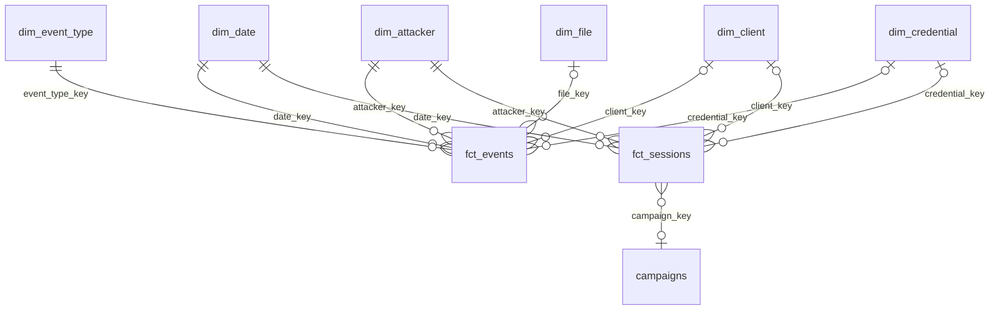

# Real-Time Honeypot Threat Intelligence Pipeline

Pipeline de date care colectează atacurile reale asupra unui honeypot SSH ([Cowrie](https://github.com/cowrie/cowrie)), le stochează într-un data lake pe S3 și le transformă într-un model dimensional (galaxy schema) pentru analiză de threat intelligence: cine atacă, cu ce credențiale, ce comenzi rulează, ce malware descarcă și care atacuri vin de la același operator.

**Pe scurt:** în 41 de zile, honeypot-ul a primit **2,1 milioane de evenimente** din **275.392 de sesiuni**, de pe **6.739 de IP-uri**. 80% din sesiunile în care s-au rulat comenzi aparțin unor **26 de campanii automate** (botnet-uri), detectate după scriptul rulat și unealta SSH folosită.

## Cuprins

- [Setul de date](#setul-de-date)
- [Arhitectură](#arhitectură)
- [Modelul de date: galaxy schema](#modelul-de-date-galaxy-schema)
- [Campanii](#campanii)
- [Ce poți face cu datele](#ce-poți-face-cu-datele)
- [Tehnologii](#tehnologii)
- [Structura proiectului](#structura-proiectului)
- [Cum rulezi](#cum-rulezi)
- [Status și pașii următori](#status-și-pașii-următori)

## Setul de date

### De unde vin datele

Cowrie e un honeypot: un server SSH/Telnet fals, expus la internet, care simulează un sistem Linux. Orice conexiune primită e un atac sau o scanare, pentru că serverul nu are utilizatori reali. Cowrie acceptă login-ul, îi dă atacatorului un shell simulat și înregistrează tot: conexiunea, clientul SSH, parolele încercate, comenzile rulate, fișierele descărcate și traficul trimis prin tunel.

Fiecare acțiune devine un **eveniment** JSON, cu un tip (`eventid`) și un `session` care leagă toate evenimentele aceleiași conexiuni.

### Perioada și volumul

| | |
|---|---|
| Perioada | 01.09.2026 – 11.10.2026 (41 de zile) |
| Evenimente | 2.097.515 |
| Sesiuni (conexiuni) | 275.392 |
| IP-uri atacatoare | 6.739, dintre care 3.485 s-au logat cu succes |
| Perechi user/parolă distincte | 85.238 |
| Comenzi distincte | 540 |
| Fișiere descărcate/urcate distincte | 92 |
| Clienți SSH distincți (versiune + HASSH) | 627 |
| Ziua cu cele mai multe sesiuni | 05.10.2026 (23.596 de sesiuni) |

### Cum arată o sesiune tipică

O sesiune trece prin aceiași pași, iar fiecare pas generează unul sau mai multe evenimente:

```
connect ──► client.version / client.kex ──► login.success / login.failed ──► command.input ... ──► session.closed
            (ce program SSH folosește)       (user + parolă)                  (ce rulează)
                                                                              file_download (ce descarcă)
                                                                              direct-tcpip.* (folosește honeypot-ul ca proxy)
```

| Categorie | Tipuri de evenimente | Evenimente |
|---|---|---:|
| sesiune | `session.connect`, `session.closed`, `session.params`, `log.closed` | 1.031.962 |
| client SSH | `client.version`, `client.kex`, `client.fingerprint`, `client.size`, ... | 522.725 |
| login | `login.success`, `login.failed` | 253.122 |
| comenzi | `command.input`, `command.failed`, `command.success`, `command.chpasswd` | 244.145 |
| tunel | `direct-tcpip.request`, `.data`, `.ja4`, `.ja4h` | 42.911 |
| fișiere | `session.file_download`, `.file_upload`, `.file_download.failed` | 2.650 |

### Ce se vede în date

- **Aproape toate atacurile sunt automate.** Cel mai rulat lucru e `uname -s -v -n -r -m` (137.035 de execuții): botul verifică ce sistem a nimerit înainte să decidă ce face mai departe. Clientul SSH dominant e `SSH-2.0-Go`, adică scripturi scrise în Go, nu oameni cu un terminal.
- **Login-ul reușește aproape mereu (99%)**, pentru că așa e configurat Cowrie: acceptă orice parolă, cu câteva excepții. Excepțiile se văd direct în date: `root/123456` (1.361 de încercări) și `root/root` (934) au 0 reușite.
- **Credențialele încercate** sunt cele implicite sau slabe: `0/0`, `ubuntu/123456`, `ubuntu/ubuntu`, `admin/admin`, `root/12345678`. Perechea `345gs5662d34/345gs5662d34` (1.650 de încercări) e semnătura unui botnet cunoscut.
- **Persistență prin chei SSH.** Cea mai răspândită campanie șterge `~/.ssh` și pune cheia publică a atacatorului în `authorized_keys`, ca să revină fără parolă (vezi [Campanii](#campanii)).
- **Honeypot-ul e folosit ca proxy.** 7.471 de sesiuni au deschis tunele `direct-tcpip`, cele mai multe spre IP-uri Google pe portul 80. Atacatorii testează dacă proxy-ul funcționează înainte să-l folosească.

## Arhitectură

```
 ┌──────────────┐  upload_logs.sh   ┌──────────────────────── S3 ────────────────────────┐
 │ Cowrie       │  (json → gzip)    │ raw/dt=YYYY-MM-DD/cowrie.json.gz                   │
 │ honeypot     │ ────────────────► │        │ Airflow: convert (DuckDB)                 │
 │ SSH / Telnet │                   │        ▼                                           │
 └──────────────┘                   │ bronze/cowrie_events/dt=YYYY-MM-DD/events.parquet  │
                                    └────────┬───────────────────────────────────────────┘
                                             │ Airflow: load
                                             ▼
                       ┌──────────────── warehouse.duckdb ────────────────┐
                       │ bronze.cowrie_events      (tabel, copie 1:1)     │
                       │        │ dbt                                     │
                       │        ▼                                         │
                       │ silver.stg_cowrie_events  (view, curățat)        │
                       │        │ dbt                                     │
                       │        ▼                                         │
                       │ gold: fct_events, fct_sessions, dim_*, campaigns │
                       └──────────────────────────────────────────────────┘
```

| Strat | Unde | Format | Ce conține |
|---|---|---|---|
| raw | S3 `raw/` | JSON lines, gzip | logurile Cowrie exact cum ies din honeypot, o zi per fișier |
| bronze | S3 `bronze/` + `bronze.cowrie_events` | Parquet (zstd) / tabel DuckDB | aceleași date, cu tipuri detectate automat |
| silver | `silver.stg_cowrie_events` | view dbt | coloane redenumite, cheie unică per eveniment, testat |
| gold | `gold.fct_*`, `gold.dim_*`, `gold.campaigns` | tabele dbt | model dimensional pentru analiză |

## Modelul de date: galaxy schema

Stratul gold are **două tabele de fapte** care folosesc aceleași dimensiuni. Un model cu mai multe tabele de fapte care împart dimensiuni comune (*conformed dimensions*) se numește **galaxy schema** (sau *fact constellation*). E extensia naturală a unui star schema: regula lui Kimball e un tabel de fapte per granularitate, nu un singur tabel de fapte per model.



### Tabelele de fapte

| Tabel | Granularitate (un rând =) | Rânduri | La ce întrebări răspunde |
|---|---|---:|---|
| `fct_events` | un eveniment Cowrie | 2.097.515 | ce parole se încearcă, ce comenzi se rulează, ce fișiere se descarcă |
| `fct_sessions` | o sesiune (conexiune) | 275.392 | cât durează un atac, câte au login reușit, ce script a rulat atacatorul |

`fct_sessions` e un **tabel de fapte agregat**: e construit din `fct_events`, nu direct din sursă. Pe `fct_events` ai putea răspunde și la întrebări despre sesiuni, dar fiecare interogare ar trebui să refacă un `group by session_id` pe 2 milioane de rânduri. Unele măsuri nici nu există la nivel de eveniment, de exemplu `command_sequence` (lista ordonată a comenzilor) sau `login_success`. Testele dbt verifică că cele două tabele se potrivesc: suma evenimentelor pe sesiuni e egală cu numărul de evenimente.

### Dimensiunile

Fiecare dimensiune are o cheie surogat (`md5` din cheia naturală), deci aceleași chei se calculează identic în ambele tabele de fapte.

| Dimensiune | Un rând = | Cheie naturală | Rânduri |
|---|---|---|---:|
| `dim_date` | o zi | data | 41 |
| `dim_event_type` | un tip de eveniment | `event_type` | 23 |
| `dim_attacker` | un IP sursă | `src_ip` | 6.739 |
| `dim_client` | un client SSH | versiune + HASSH | 627 |
| `dim_credential` | o pereche user/parolă | username + password | 85.238 |
| `dim_file` | un fișier descărcat/urcat | SHA256 | 92 |

Cheile `client_key`, `credential_key` și `file_key` sunt NULL pe evenimentele care nu au legătură cu dimensiunea respectivă (de exemplu, un `session.connect` nu are credențiale).

### `campaigns`

Peste `fct_sessions` stă `campaigns` (26 de rânduri), un tabel de analiză cu un rând per campanie. Nu e o dimensiune propriu-zisă: `fct_sessions.campaign_key` există pentru orice sesiune cu comenzi (258 de semnături distincte), dar doar semnăturile văzute de pe cel puțin 10 IP-uri ajung în `campaigns`. Explicația completă e în secțiunea următoare.

Toate coloanele și deciziile de design: [docs/data_model.md](docs/data_model.md).

## Campanii

### Problema

Un botnet atacă de pe sute sau mii de IP-uri, care se schimbă mereu. Dacă te uiți doar la IP-uri, vezi 6.739 de atacatori independenți. În realitate, cea mai mare parte vin de la câțiva operatori.

### Ideea

Două lucruri rămân la fel pe toate IP-urile unui botnet, pentru că vin din același cod:

1. **Scriptul**: comenzile rulate într-o sesiune, în aceeași ordine.
2. **Unealta**: programul SSH cu care se conectează, identificat prin **HASSH**. La conectare, clientul SSH trimite lista algoritmilor de criptare pe care îi știe, în ordinea lui. Fiecare program (OpenSSH, PuTTY, `libssh`, biblioteca SSH din Go) are lista lui, iar HASSH e hash-ul acestei liste. Cowrie îl calculează singur.

**O campanie = aceeași unealtă (HASSH) + același script, văzute de pe cel puțin 10 IP-uri diferite.**

### Cum se calculează

```
fct_events ──► fct_sessions ──────────────────────────────────────► campaigns
               command_sequence      = "cd ~; chattr -ia .ssh ; ..."   group by campaign_key
               command_sequence_hash = md5(comenzi normalizate)        having count(distinct IP) >= 10
               campaign_key          = md5(hassh | command_sequence_hash)
```

Înainte de hash, comenzile sunt **normalizate**: cifrele și șirurile hex lungi devin `N`. Unele scripturi pun valori aleatoare în comenzi (parole noi, nume de fișiere), iar fără normalizare fiecare rulare ar părea un script diferit.

Pragul de 10 IP-uri e variabila dbt `campaign_min_ips`:

```bash
dbt build --select campaigns --vars '{campaign_min_ips: 20}' --profiles-dir .
```

### Rezultate

26 de campanii, de pe 3.007 IP-uri, care acoperă 187.980 de sesiuni (80% din sesiunile cu comenzi). Cele mai mari, după numărul de IP-uri:

| Ce face scriptul | IP-uri | Sesiuni | Zile active |
|---|---:|---:|---:|
| **Implant de cheie SSH** (`mdrfckr`): șterge `~/.ssh`, scrie cheia atacatorului în `authorized_keys`, blochează fișierul | 1.052 | 1.529 | 41 |
| Recunoaștere: `uname -a 2>/dev/null` | 946 | 8.343 | 6 |
| Recunoaștere: `uname -a 2>/dev/null`, altă unealtă SSH | 660 | 21.359 | 13 |
| Recunoaștere: `uname -s -v -n -r -m` | 131 | 136.938 | 39 |
| Implant de cheie SSH, același script, altă unealtă SSH | 73 | 136 | 37 |
| Recunoaștere routere MikroTik + căutare de minere concurente (`/ip cloud print`, `ps \| grep '[Mm]iner'`, ...) | 32 | 37 | 24 |

Câteva observații:

- **Implantul `mdrfckr`** e activ în fiecare zi din perioada colectată. Rulează de pe 1.052 de IP-uri, dar cu aceeași cheie publică, deci e un singur operator. Fișierul `authorized_keys` creat de script e înregistrat de Cowrie ca `file_download` și are mereu același hash.
- **Același script cu unelte diferite** apare ca două campanii (rândurile 1 și 5). Pot fi versiuni diferite ale aceluiași bot sau operatori care au copiat scriptul.
- **Raportul sesiuni / IP-uri** arată comportamentul: campania `uname -s -v -n -r -m` are 131 de IP-uri, dar 136.938 de sesiuni, adică fiecare IP revine de peste 1.000 de ori. Implantul de cheie vine o dată sau de două ori de pe fiecare IP.

### Limitări

- Scripturile cu o singură comandă scurtă (`uname -a`) sunt semnături slabe: aceeași comandă poate veni de la operatori diferiți, iar HASSH-ul îi separă doar dacă folosesc unelte diferite.
- Potrivirea e exactă: un script care schimbă ordinea comenzilor sau adaugă una apare ca altă campanie.
- Sesiunile fără comenzi (doar login, doar tunel) nu au semnătură, deci nu intră în nicio campanie.

## Ce poți face cu datele

### Întrebări la care poți răspunde deja

**Care sunt cele mai mari campanii și de pe ce IP-uri atacă?**

```sql
select hassh, attackers, sessions, active_days, example_command_sequence
from gold.campaigns
order by attackers desc;

-- IP-urile unei campanii
select a.src_ip, count(*) as sessions, min(s.started_at) as first_seen
from gold.fct_sessions s
join gold.dim_attacker a using (attacker_key)
where s.campaign_key = '<campaign_key>'
group by 1
order by 2 desc;
```

**Ce parole încearcă atacatorii?** Util ca listă de parole interzise în propria infrastructură.

```sql
select username, password, attempts
from gold.dim_credential
order by attempts desc
limit 50;
```

**Ce malware descarcă?** Hash-urile SHA256 se pot căuta direct pe [VirusTotal](https://www.virustotal.com) sau [MalwareBazaar](https://bazaar.abuse.ch).

```sql
select fl.file_sha256, fl.first_url, fl.downloads, count(distinct f.attacker_key) as attackers
from gold.fct_events f
join gold.dim_file fl using (file_key)
group by all
order by attackers desc;
```

**Cum evoluează atacurile în timp?**

```sql
select d.date_day, count(*) as sessions, count(*) filter (where s.campaign_key is not null) as with_commands
from gold.fct_sessions s
join gold.dim_date d using (date_key)
group by 1
order by 1;
```

**Care atacatori folosesc honeypot-ul ca proxy și spre ce destinații?**

```sql
select tunnel_dst_ip, tunnel_dst_port, count(*) as requests, count(distinct attacker_key) as attackers
from gold.fct_events
where tunnel_dst_ip is not null
group by all
order by requests desc
limit 20;
```

Mai multe interogări: [docs/data_model.md](docs/data_model.md#interogări-utile) și [analysis/explore.sql](analysis/explore.sql).

### Idei de extindere

| Idee | Ce adaugă | Cum |
|---|---|---|
| **Geo-IP și ASN** | din ce țări și de la ce furnizori de hosting vin atacurile | `dim_attacker` + o bază [MaxMind GeoLite2](https://dev.maxmind.com/geoip/geolite2-free-geolocation-data) sau [ipinfo](https://ipinfo.io) |
| **Clasificarea comenzilor** | ce urmăresc atacatorii: recunoaștere, persistență, download, mining | `dim_command` cu reguli pe text, mapate pe tactici [MITRE ATT&CK](https://attack.mitre.org) |
| **Blocklist** | o listă de IP-uri de blocat, exportată zilnic | IP-urile campaniilor active în ultimele N zile, scrise în S3 de un task Airflow |
| **Alertă pentru campanii noi** | află când apare un script nou | un test dbt sau un task care compară `campaigns` cu ziua precedentă |
| **Îmbogățirea fișierelor** | familia malware-ului (Mirai, XMRig, ...) | lookup SHA256 în API-ul VirusTotal sau MalwareBazaar |
| **Dashboard** | vizualizare pentru cine nu scrie SQL | Evidence, Metabase sau Superset peste `gold` |

## Tehnologii

- **Cowrie**: honeypot SSH/Telnet, rulat în Docker (`infra/honeypot/`)
- **AWS S3**: data lake (zonele raw și bronze)
- **Apache Airflow 3.3**: orchestrare (`dags/honeypot_dag.py`)
- **DuckDB 1.5**: conversie JSON → Parquet direct în S3 și data warehouse local
- **dbt (dbt-duckdb)**: transformări, teste și modelul dimensional (`dbt_project/`)
- **Docker Compose**: Airflow + Postgres (metadate Airflow)

## Structura proiectului

```
.
├── infra/honeypot/docker-compose.yml   # containerul Cowrie
├── ingest/upload_logs.sh               # urcă logurile zilnice Cowrie în S3 (raw/)
├── dags/honeypot_dag.py                # DAG Airflow: convert → load → validate
├── dbt_project/
│   ├── dbt_project.yml
│   ├── profiles.yml                    # conexiunea DuckDB (DUCKDB_PATH)
│   ├── macros/generate_schema_name.sql # schemele se numesc exact silver / gold
│   ├── models/
│   │   ├── staging/                    # silver: stg_cowrie_events + teste
│   │   └── marts/                      # gold: fct_*, dim_*, campaigns + teste
│   └── tests/                          # teste de reconciliere între tabele
├── analysis/explore.sql                # interogări ad-hoc pe datele din S3
├── docs/data_model.md                  # documentația modelului de date
├── Dockerfile                          # imaginea Airflow (+ dbt într-un venv separat)
├── docker-compose.yml                  # Airflow + Postgres
└── .env.example
```

## Cum rulezi

### 1. Honeypot-ul (pe serverul expus la internet)

```bash
cd infra/honeypot
docker compose up -d
```

Cowrie ascultă pe porturile 2222 (SSH) și 2223 (Telnet). Logurile ajung în `infra/honeypot/var/log/cowrie/`, rotite zilnic (`cowrie.json.YYYY-MM-DD`).

`ingest/upload_logs.sh` comprimă fiecare zi încheiată și o urcă în `s3://<bucket>/raw/dt=YYYY-MM-DD/cowrie.json.gz`. Ține evidența fișierelor deja urcate în `.uploaded_logs`, deci poate fi rulat periodic (de exemplu din cron) fără duplicate.

### 2. Airflow

```bash
cp .env.example .env        # completează AIRFLOW_JWT_SECRET și AIRFLOW_API_SECRET_KEY
docker compose up -d
```

UI-ul Airflow e la http://localhost:8085. Credențialele AWS sunt citite din `~/.aws` (montat read-only în containere).

DAG-ul `honeypot_dag` rulează zilnic la 04:00 UTC:

1. **convert**: pentru fiecare zi din `raw/` care nu există încă în `bronze/`, DuckDB citește JSON-ul direct din S3 și scrie Parquet înapoi în S3. Parametrul `full_refresh=true` reconvertește toate zilele.
2. **load**: reconstruiește `bronze.cowrie_events` în `warehouse.duckdb` din toate fișierele Parquet (`union_by_name`, pentru că zilele pot avea coloane diferite).
3. **validate**: deocamdată doar un placeholder.

### 3. dbt

```bash
python -m venv .venv && source .venv/bin/activate
pip install dbt-duckdb

cd dbt_project
dbt build --profiles-dir .     # rulează modelele și testele
```

Implicit, dbt scrie în `../warehouse.duckdb`; se poate schimba cu variabila `DUCKDB_PATH`.

`dbt build` rulează 74 de teste:

- **unicitate și not null** pe cheile surogat și naturale ale fiecărei dimensiuni și pe cheile primare ale tabelelor de fapte;
- **integritate referențială** (`relationships`): fiecare FK din `fct_events` și `fct_sessions` există în dimensiunea lui;
- **reconciliere** (`dbt_project/tests/`): `fct_events` are câte rânduri are staging-ul, iar totalurile din `fct_sessions`, `dim_attacker` și `campaigns` se potrivesc cu tabelele din care sunt construite;
- **reguli de business**: cheile opționale apar doar pe tipurile de evenimente potrivite, o sesiune cu login reușit are credențiale, o campanie are cel puțin `campaign_min_ips` IP-uri.

> DuckDB permite un singur proces care scrie în fișier. Închide orice client deschis pe `warehouse.duckdb` (CLI, UI, DBeaver) înainte de `dbt build` sau de task-ul `load`.

### 4. Explorare

```bash
duckdb warehouse.duckdb -ui    # UI la http://localhost:4213
```

În notebook-urile din UI, scrie numele complet al tabelelor (`warehouse.gold.fct_events`) sau rulează `use warehouse;` la început. Altfel celula poate rula pe baza in-memory și dă `Catalog "..." does not exist`.

## Status și pașii următori

- [x] Honeypot Cowrie în Docker
- [x] Upload zilnic al logurilor în S3 (raw)
- [x] Airflow: raw → bronze (Parquet) → DuckDB
- [x] dbt staging (silver) cu teste
- [x] dbt galaxy schema (gold): `fct_events` + `fct_sessions` + 6 dimensiuni comune
- [x] Detectarea campaniilor (`campaigns`) după secvența de comenzi + HASSH
- [x] Teste de reconciliere între tabelele gold
- [ ] `dbt build` ca task în DAG, în locul placeholder-ului `validate`
- [ ] Îmbogățire IP-uri: țară, ASN (geo-IP)
- [ ] Clasificarea comenzilor (recon, persistence, download, mining)
- [ ] Dashboard peste stratul gold
