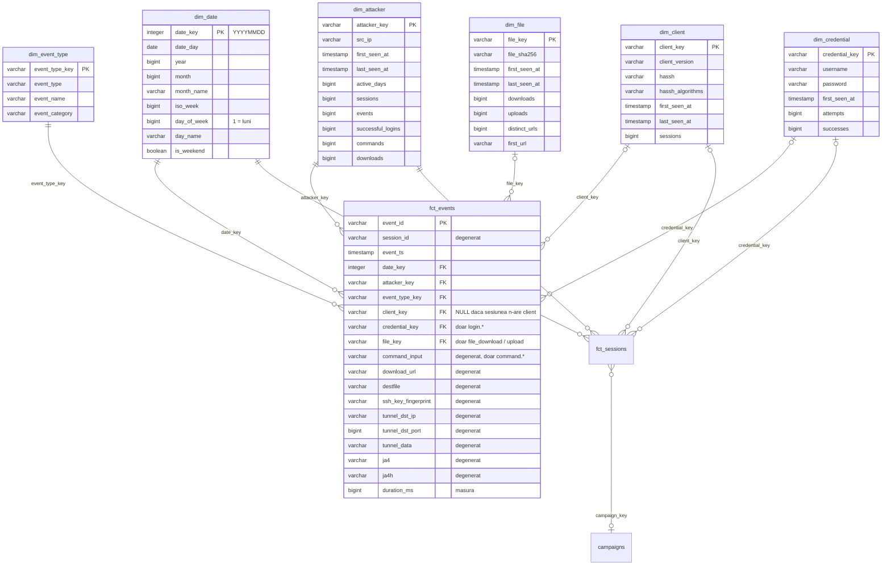

# Modelul de date

Documentația straturilor din `warehouse.duckdb` și a modelului dimensional. Cifrele sunt pentru datele din 01.09.2026 – 11.10.2026.

## Concepte

| Concept | Ce înseamnă | Cheie | Număr |
|---|---|---|---|
| Atacator | o mașină de pe internet care se conectează la honeypot | `src_ip` | 6.739 |
| Sesiune | o conexiune a unui atacator, de la conectare până la deconectare | `session_id` | 275.392 |
| Eveniment | un pas dintr-o sesiune: conectare, login, comandă, download, deconectare | `event_id` | 2.097.515 |

Un atacator are multe sesiuni (majoritatea sunt boți care revin des), iar o sesiune are în medie 7–8 evenimente. O sesiune tipică:

```
cowrie.session.connect      atacatorul se conectează
cowrie.client.version       trimite versiunea clientului SSH
cowrie.client.kex           negociază algoritmii (de aici vine hassh)
cowrie.login.success        se loghează (username / password)
cowrie.session.params
cowrie.command.input        rulează o comandă
cowrie.log.closed           Cowrie închide înregistrarea sesiunii (ttylog)
cowrie.session.closed       se deconectează (duration_ms)
```

Comenzile nu se execută de fapt: Cowrie simulează un sistem Linux și doar le înregistrează.

## Bronze: `bronze.cowrie_events`

Încărcat de task-ul `load` din Airflow, din `s3://<bucket>/bronze/cowrie_events/dt=*/events.parquet`. Tabelul e reconstruit complet la fiecare rulare.

Este un tabel „lat” și rar: are o coloană (52 în total) pentru orice câmp care apare în **orice** tip de eveniment, dar fiecare rând completează doar coloanele care țin de tipul lui. Restul sunt NULL.

## Silver: `silver.stg_cowrie_events`

View dbt (`models/staging/stg_cowrie_events.sql`). Un rând = un eveniment. Nu filtrează și nu agregă nimic; doar:

- redenumește coloanele în `snake_case` și cu nume clare (`input` → `command_input`, `shasum` → `file_sha256`, `hasshAlgorithms` → `hassh_algorithms`, ...);
- adaugă o cheie unică `event_id = md5(session || timestamp || eventid)`;
- adaugă `event_name`, adică `event_type` fără prefixul `cowrie.`.

### De ce `event_id` e calculat

Cowrie nu are un ID per eveniment. Coloana `uuid` din log e ID-ul instanței Cowrie: are aceeași valoare pe toate rândurile. Combinația `(session, timestamp, eventid)` e unică pe toate rândurile, așa că `event_id` e un hash al ei.

### Coloane completate în funcție de tipul evenimentului

Pe toate rândurile: `event_id`, `session_id`, `event_ts`, `event_date`, `event_type`, `event_name`, `src_ip`, `src_port`, `dst_ip`, `dst_port`, `sensor_name`, `protocol`.

`src_ip` / `src_port` sunt atacatorul și sunt constante pe toată sesiunea. `dst_ip` / `dst_port` sunt honeypot-ul (IP-ul intern al containerului și portul 2222), cu excepția evenimentelor `direct-tcpip.*`, unde sunt destinația tunelului.

| `event_type` | Coloane specifice |
|---|---|
| `client.version` | `client_version` |
| `client.kex` | `hassh`, `hassh_algorithms`, `kex_algs`, `key_algs`, `enc_cs`, `mac_cs`, `comp_cs`, `lang_cs` |
| `client.fingerprint` | `username`, `ssh_key_fingerprint`, `ssh_public_key`, `ssh_key_type` (autentificare cu cheie publică) |
| `login.success` / `login.failed` | `username`, `password` (lipsește la unele `login.failed`) |
| `command.input` / `.success` / `.failed` | `command_input` |
| `session.file_download` / `file_upload` | `file_sha256`, `download_url` (nu mereu), `outfile`, `destfile`, `filename` |
| `session.file_download.failed` | `download_url` |
| `direct-tcpip.*` | `tunnel_dst_ip`, `tunnel_dst_port` (din `dst_ip` / `dst_port`), `tunnel_orig_ip`, `tunnel_orig_port`, `tunnel_data`, `ja4`, `ja4h` |
| `log.closed` | `ttylog`, `file_sha256` (hash-ul ttylog), `file_size_bytes`, `duration_ms` |
| `session.closed` | `duration_ms` |

### Teste (`models/staging/schema.yml`)

- `event_id`: `unique`, `not_null`
- `session_id`, `event_ts`, `event_date`, `src_ip`, `sensor_name`, `event_type`: `not_null`
- `protocol`: `accepted_values` (`ssh`, `telnet`)
- `event_type`: `accepted_values` cu cele 23 de tipuri cunoscute, `severity: warn`, ca un tip nou de eveniment Cowrie să dea un avertisment fără să oprească pipeline-ul
- `username` pe `login.*`, `command_input` pe `command.input`, `file_sha256` pe `file_download`: `not_null` condiționat (`where`)

## Gold: galaxy schema

Tabele dbt în `models/marts/`, materializate în schema `gold`.

Modelul are **două tabele de fapte** cu granularități diferite, `fct_events` (un eveniment) și `fct_sessions` (o sesiune), care folosesc aceleași dimensiuni (*conformed dimensions*). Un astfel de model se numește **galaxy schema** sau *fact constellation*: regula lui Kimball e un tabel de fapte per proces și granularitate, nu unul singur per model. Peste `fct_sessions` stă tabelul de analiză `campaigns`.



`||--o{`: fiecare eveniment are obligatoriu o valoare în dimensiune. `|o--o{`: cheia poate lipsi (NULL) pe evenimentele fără legătură cu dimensiunea. Coloanele din `fct_sessions` și `campaigns` sunt descrise în [Sesiuni și campanii](#sesiuni-și-campanii).

| Tabel | Rol | Un rând = | Rânduri |
|---|---|---|---:|
| `fct_events` | fapt, granularitate fină | un eveniment | 2.097.515 |
| `fct_sessions` | fapt agregat, construit din `fct_events` | o sesiune | 275.392 |
| `campaigns` | tabel de analiză, construit din `fct_sessions` | o campanie | 26 |
| `dim_*` | dimensiuni comune ambelor fapte | vezi [Dimensiuni](#dimensiuni) | |

### `fct_events`

Un rând = un eveniment (2.097.515 rânduri).

| Coloană | Tip | Descriere |
|---|---|---|
| `event_id` | PK | cheia evenimentului (din staging) |
| `session_id` | dimensiune degenerată | sesiunea din care face parte evenimentul |
| `event_ts` | timestamp | momentul evenimentului (UTC) |
| `date_key` | FK → `dim_date` | `YYYYMMDD` |
| `attacker_key` | FK → `dim_attacker` | mereu completat |
| `event_type_key` | FK → `dim_event_type` | mereu completat |
| `client_key` | FK → `dim_client` | clientul SSH al **sesiunii**; NULL dacă sesiunea nu și-a trimis versiunea sau hassh-ul |
| `credential_key` | FK → `dim_credential` | doar pe `login.success` / `login.failed` |
| `file_key` | FK → `dim_file` | doar pe `file_download` / `file_upload` |
| `command_input` | degenerat | textul comenzii, pe `command.input` / `.success` / `.failed` |
| `download_url` | degenerat | URL-ul descărcării (inclusiv la download-urile eșuate) |
| `destfile` | degenerat | calea unde atacatorul a salvat fișierul pe honeypot |
| `ssh_key_fingerprint` | degenerat | fingerprint-ul cheii publice cu care s-a autentificat atacatorul; același fingerprint pe IP-uri diferite indică, de regulă, același operator |
| `tunnel_dst_ip`, `tunnel_dst_port` | degenerate | unde a încercat atacatorul să ajungă folosind honeypot-ul ca proxy, la `direct-tcpip.*` |
| `tunnel_data` | degenerat | datele trimise prin tunel (de obicei o cerere HTTP) |
| `ja4`, `ja4h` | degenerate | fingerprint-urile TLS (JA4) și HTTP (JA4H) ale traficului din tunel; identifică unealta folosită |
| `duration_ms` | măsură | durata, pe `session.closed` și `log.closed` |

### Dimensiuni

| Dimensiune | Cheie naturală | Rânduri | Atribute |
|---|---|---|---|
| `dim_date` | data | 41 | `date_day`, `year`, `month`, `month_name`, `iso_week`, `day_of_week` (1 = luni), `day_name`, `is_weekend` |
| `dim_event_type` | `event_type` | 23 | `event_name`, `event_category` (`session`, `client`, `login`, `command`, `log`, `direct-tcpip`) |
| `dim_attacker` | `src_ip` | 6.739 | `first_seen_at`, `last_seen_at`, `active_days`, `sessions`, `events`, `successful_logins`, `commands`, `downloads` |
| `dim_client` | `client_version` + `hassh` | 627 | `hassh_algorithms`, `first_seen_at`, `last_seen_at`, `sessions` |
| `dim_credential` | `username` + `password` | 85.238 | `first_seen_at`, `attempts`, `successes` |
| `dim_file` | `file_sha256` | 92 | `first_seen_at`, `last_seen_at`, `downloads`, `uploads`, `distinct_urls`, `first_url` |

### Decizii de design

**Factul de bază e la nivel de eveniment.** `fct_events` are cea mai fină granularitate disponibilă. Atributele specifice fiecărui tip de eveniment (credențiale, fișiere, client) sunt mutate în dimensiuni, iar factul păstrează doar cheile.

**Al doilea fact, agregat la nivel de sesiune.** Întrebările despre sesiuni (durată, login reușit, ce script s-a rulat) ar cere un `group by session_id` pe 2 milioane de rânduri la fiecare interogare, iar unele măsuri (`command_sequence`, `login_success`) nu există la nivel de eveniment. `fct_sessions` le calculează o singură dată. E construit din `fct_events`, nu din staging, deci cheile către dimensiuni sunt aceleași, iar testele de reconciliere verifică că totalurile se potrivesc.

**Chei surogat `md5` din cheia naturală.** De exemplu `attacker_key = md5(src_ip)`. Factul și dimensiunile calculează aceeași cheie independent, fără join-uri între ele la construire. Pentru cheile compuse cu valori care pot lipsi, NULL e înlocuit cu `'<null>'` înainte de hash, ca două combinații diferite să nu ajungă la aceeași cheie.

**Chei opționale NULL.** `client_key`, `credential_key` și `file_key` sunt NULL pe evenimentele fără legătură cu dimensiunea respectivă. Testele `relationships` din dbt ignoră NULL-urile.

**Clientul SSH e atribuit întregii sesiuni.** Versiunea vine pe `client.version`, iar hassh-ul pe `client.kex`, adică pe evenimente diferite. Fiecare sesiune are cel mult o versiune și un hassh, așa că `client_key` e pus pe toate evenimentele sesiunii. Asta permite filtrarea oricărui eveniment după unealta folosită de atacator.

**`dim_file` ia doar fișierele atacatorilor.** `shasum` apare și pe `cowrie.log.closed`, dar acolo e hash-ul înregistrării sesiunii (ttylog). Dacă ar fi fost incluse, `dim_file` ar fi avut 448 de rânduri în loc de 92.

**Credențialele sunt o dimensiune proprie**, nu atribute degenerate în fact, pentru că perechea user/parolă are atribute calculate utile (număr de încercări, câte au reușit, prima apariție).

**Comanda e atribut degenerat în fact.** `command_input` stă direct în `fct_events`: textul comenzii nu are alte atribute descriptive, iar statisticile (de câte ori a rulat, de câți atacatori) se obțin cu `group by command_input`. O `dim_command` ar avea sens dacă se adaugă clasificarea comenzilor (recon, persistence, download, mining).

**Fără dimensiune de senzor.** Există un singur honeypot. `sensor_name` din Cowrie e hostname-ul containerului Docker, adică ID-ul lui, și s-a schimbat când containerul a fost recreat (02.09.2026, 16:40), deși `sensor_uuid` a rămas același. O `dim_sensor` ar fi avut două rânduri pentru același senzor. Se poate adăuga când există mai mulți honeypot-i, cheiată pe `sensor_uuid` și cu atribute ca regiunea sau providerul. `sensor_name` rămâne disponibil în `silver.stg_cowrie_events`.

## Sesiuni și campanii

Al doilea tabel de fapte și tabelul de analiză construit peste el.

```
fct_events + dimensiuni  ──►  fct_sessions  ──►  campaigns
un rând = un eveniment       un rând = o sesiune  un rând = o campanie
```

### Ce e o campanie

Un operator (de obicei un botnet) atacă de pe sute sau mii de IP-uri, care se schimbă mereu. Două lucruri rămân însă la fel pe toate IP-urile, pentru că vin din același cod:

- **scriptul**: comenzile rulate într-o sesiune, în aceeași ordine;
- **unealta**: programul SSH cu care se conectează, identificat prin **HASSH**. Când un client SSH se conectează, trimite lista algoritmilor de criptare pe care îi cunoaște, în ordinea lui. Fiecare program (OpenSSH, PuTTY, `libssh`, biblioteca SSH din Go) are lista lui, iar HASSH e un hash al acestei liste. Cowrie îl calculează singur, pe evenimentul `cowrie.client.kex`.

O campanie = aceeași unealtă (HASSH) + același script, văzute de pe cel puțin 10 IP-uri diferite.

### `fct_sessions`

Un rând = o sesiune (275.392 rânduri).

| Coloană | Descriere |
|---|---|
| `session_id` | PK |
| `date_key`, `attacker_key`, `client_key` | FK către dimensiuni (data = ziua începutului sesiunii) |
| `credential_key` | FK → `dim_credential`: ultima pereche user/parolă cu care s-a logat cu succes |
| `campaign_key` | semnătura sesiunii: `md5(hassh \| command_sequence_hash)`; NULL dacă sesiunea n-a rulat comenzi. Sesiunea face parte dintr-o campanie doar dacă cheia există în `campaigns` |
| `hassh` | din `dim_client`, copiat pentru comoditate |
| `started_at`, `ended_at`, `duration_ms` | durata, din `session.closed` |
| `events`, `login_attempts`, `login_success` | |
| `commands`, `command_sequence` | numărul și lista comenzilor, în ordinea rulării, separate prin ` ; ` |
| `command_sequence_hash` | hash-ul listei de comenzi normalizate (vezi mai jos) |
| `downloads`, `uploads`, `tunnel_requests` | |
| `ssh_key_fingerprint` | cheia publică folosită la autentificare, dacă există |

**Normalizarea comenzilor.** Unele scripturi pun în comenzi valori aleatoare (parole noi, nume de fișiere). Înainte de hash, cifrele și șirurile hex de cel puțin 6 caractere sunt înlocuite cu `N`, ca toate rulările aceluiași script să dea același hash.

### `campaigns`

Un rând = o campanie (26 de rânduri, care acoperă 187.980 de sesiuni). Pragul minim de IP-uri e variabila dbt `campaign_min_ips` (implicit 10):

```bash
dbt build --select campaigns --vars '{campaign_min_ips: 20}' --profiles-dir .
```

| Coloană | Descriere |
|---|---|
| `campaign_key` | PK, aceeași valoare ca în `fct_sessions.campaign_key` |
| `hassh`, `command_sequence_hash` | semnătura campaniei |
| `example_command_sequence` | scriptul, așa cum a fost rulat într-una din sesiuni |
| `commands_per_session` | câte comenzi are scriptul |
| `attackers`, `sessions` | câte IP-uri și câte sesiuni |
| `first_seen_at`, `last_seen_at`, `active_days` | |
| `downloads`, `distinct_files` | fișierele descărcate de campanie |
| `distinct_ssh_keys` | câte chei SSH publice diferite au folosit |

**Limitări.** Scripturile cu o singură comandă scurtă (`uname -a`) sunt semnături slabe: aceeași comandă poate veni de la operatori diferiți, iar HASSH-ul îi separă doar dacă folosesc unelte diferite. Un script care schimbă puțin ordinea comenzilor sau adaugă o comandă apare ca altă campanie, pentru că potrivirea e exactă.

## Teste gold

`dbt build` rulează 74 de teste în total (staging + gold).

### Teste generice (`models/marts/schema.yml`)

- fiecare dimensiune: cheia surogat `unique` + `not_null`;
- cheile naturale: `dim_attacker.src_ip`, `dim_file.file_sha256`, `dim_event_type.event_type`, `dim_date.date_day`: `unique` + `not_null`; `dim_credential.username`: `not_null`. Fără ele, o dimensiune dublată ar multiplica rândurile la join fără ca testul pe cheia surogat să observe;
- `fct_events.event_id`, `fct_sessions.session_id`, `campaigns.campaign_key`: `unique` + `not_null`;
- fiecare FK din `fct_events` și `fct_sessions`: `relationships` către dimensiunea lui; cele obligatorii (`date_key`, `attacker_key`, `event_type_key`) și `not_null`;
- `campaigns.campaign_key`: `relationships` către `fct_sessions`. Invers nu se testează, pentru că `fct_sessions.campaign_key` există și pentru semnăturile sub prag.

### Teste singulare (`dbt_project/tests/`)

| Test | Ce verifică |
|---|---|
| `fct_events_row_count_matches_staging` | `fct_events` are exact câte rânduri are `stg_cowrie_events` |
| `fct_sessions_reconcile_with_fct_events` | fiecare sesiune apare o dată, iar suma `events` = numărul de evenimente |
| `dim_attacker_reconcile_with_fct_events` | suma `events` din `dim_attacker` = numărul de evenimente |
| `fct_events_keys_match_event_type` | `credential_key` doar și mereu pe `login.*`; `file_key` doar pe download/upload și mereu pe download |
| `fct_sessions_consistency` | `ended_at` ≥ `started_at`; login reușit ⇔ `credential_key`; comenzi ⇔ `campaign_key` |
| `campaigns_min_ips` | fiecare campanie are cel puțin `campaign_min_ips` IP-uri |
| `campaigns_reconcile_with_fct_sessions` | sesiunile și IP-urile din `campaigns` se regăsesc în `fct_sessions` |
| `dim_date_covers_all_events` | `dim_date` e continuă, fără zile lipsă |

## Interogări utile

Cele mai încercate credențiale:

```sql
select c.username, c.password, c.attempts, c.successes
from gold.dim_credential c
order by c.attempts desc
limit 20;
```

Cele mai rulate comenzi:

```sql
select command_input, count(*) as executions, count(distinct attacker_key) as attackers
from gold.fct_events
join gold.dim_event_type using (event_type_key)
where event_type = 'cowrie.command.input'
group by command_input
order by executions desc
limit 20;
```

Activitatea pe zile, pe categorii de evenimente:

```sql
select d.date_day, t.event_category, count(*) as events
from gold.fct_events f
join gold.dim_date d using (date_key)
join gold.dim_event_type t using (event_type_key)
group by all
order by 1, 2;
```

Fișierele descărcate și de câți atacatori:

```sql
select fl.file_sha256, fl.first_url, count(distinct f.attacker_key) as attackers, fl.downloads
from gold.fct_events f
join gold.dim_file fl using (file_key)
group by all
order by attackers desc;
```

Unelte SSH (hassh) folosite de cei mai mulți atacatori:

```sql
select cl.hassh, cl.client_version, count(distinct f.attacker_key) as attackers
from gold.fct_events f
join gold.dim_client cl using (client_key)
group by all
order by attackers desc
limit 10;
```

Campaniile, de pe cele mai multe IP-uri:

```sql
select hassh, attackers, sessions, active_days, distinct_files, example_command_sequence
from gold.campaigns
order by attackers desc;
```

IP-urile unei campanii:

```sql
select a.src_ip, count(*) as sessions, min(s.started_at) as first_seen
from gold.fct_sessions s
join gold.dim_attacker a using (attacker_key)
where s.campaign_key = '<campaign_key>'
group by 1
order by 2 desc;
```
