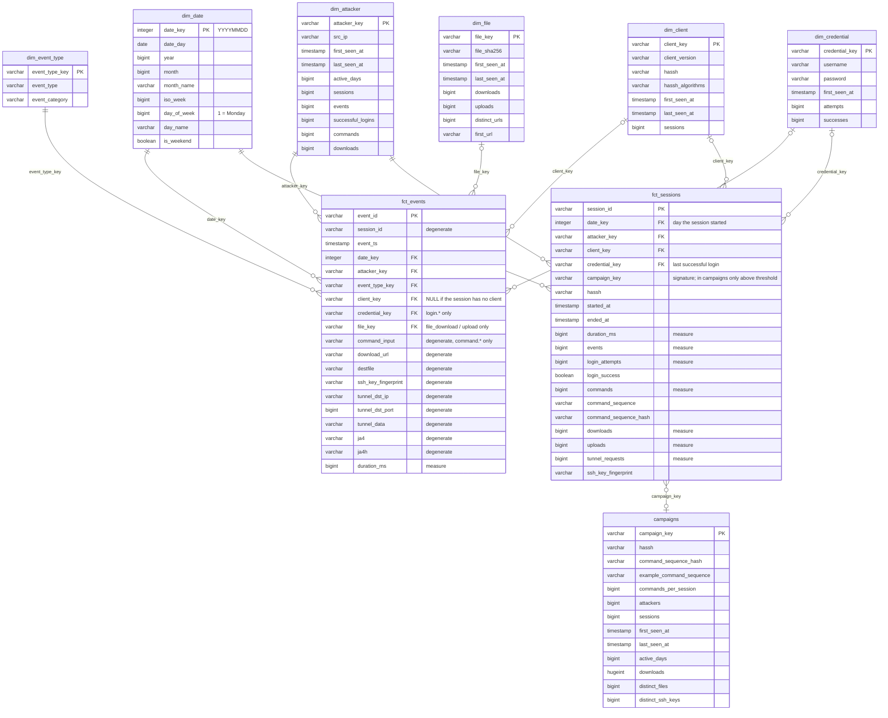

# Documentation

Technical documentation of the project. For the overview and results, see the [README](../README.md).

- [Architecture](#architecture): the components, the S3 bucket, the IAM users, the sensor
- [Data model](#data-model): the bronze, silver and gold layers, columns, campaigns, tests, useful queries
- [Operations](#operations): Airflow, dbt, exploration, known issues

## Architecture

How data flows from the honeypot to the warehouse, where it is stored and who has access to it.

### Components

The project has three components, each with its own AWS permissions:

1. **The sensor**: a Hetzner VPS exposed to the internet, running Cowrie. It only produces data and uploads it to S3.
2. **The data lake**: the S3 bucket `sundew-honeypot-diana` (region `eu-north-1`), with the `raw/` and `bronze/` zones.
3. **The analytics platform**: Airflow, DuckDB and dbt, running locally in Docker. They read from the lake, write the bronze layer back and build the warehouse.

The sensor is not in AWS: the only AWS services the project uses are S3 and IAM.

```
            INTERNET (bots, scanners)
                     │  SSH :2222 / Telnet :2223
                     ▼
┌─────────────── SENSOR (Hetzner VPS) ─────────────────┐
│  Cowrie (Docker, read-only, no capabilities)         │
│        │ var/log/cowrie/cowrie.json.YYYY-MM-DD       │
│        ▼                                             │
│  upload_logs.sh   (cron 01:00 UTC, gzip, 1 day/file) │
└────────┬─────────────────────────────────────────────┘
         │ IAM user: honeypot-sensor   (write-only to raw/)
         ▼
┌──────────── S3: s3://sundew-honeypot-diana ──────────┐
│  raw/dt=YYYY-MM-DD/cowrie.json.gz                    │
│  bronze/cowrie_events/dt=YYYY-MM-DD/events.parquet   │
└────────┬───────────────────────────────▲─────────────┘
         │ reads raw/ + bronze/          │ writes bronze/
         │ IAM user: honeypot-analyst    │
         ▼                               │
┌──────────── ANALYTICS PLATFORM (local, Docker) ──────┐
│  Airflow ── convert ─────────────────────┘           │
│     │       (DuckDB: JSON → Parquet, directly in S3) │
│     ├── load ──► warehouse.duckdb                    │
│     │             bronze.cowrie_events   (table)     │
│     │                    │ dbt                       │
│     │                    ▼                           │
│     │             silver.stg_cowrie_events (view)    │
│     │                    │ dbt                       │
│     │                    ▼                           │
│     │             gold: fct_*, dim_*, campaigns      │
│     └── validate (dbt test) ──► dbt docs             │
└──────────────────────────────────────────────────────┘
```

### Data layers

| Layer | Where | Format | Contents |
|---|---|---|---|
| raw | S3 `raw/` | JSON lines, gzip | Cowrie logs exactly as the honeypot writes them, one day per file |
| bronze | S3 `bronze/` + `bronze.cowrie_events` | Parquet (zstd) / DuckDB table | the same data, with automatically detected types |
| silver | `silver.stg_cowrie_events` | dbt view | renamed columns, unique key per event, tested |
| gold | `gold.fct_*`, `gold.dim_*`, `gold.campaigns` | dbt tables | dimensional model for analysis |

Columns and modeling decisions for each layer: [Data model](#data-model).

### The S3 bucket

Everything lives in a single bucket, `sundew-honeypot-diana`, split into zones by prefix. Each zone is partitioned by day (`dt=YYYY-MM-DD`, Hive style):

```
s3://sundew-honeypot-diana/
├── raw/                                   # what the sensor sends, untouched
│   ├── dt=2026-09-01/cowrie.json.gz
│   ├── dt=2026-09-02/cowrie.json.gz
│   └── ...
└── bronze/
    └── cowrie_events/                     # written by Airflow (the convert task)
        ├── dt=2026-09-01/events.parquet
        ├── dt=2026-09-02/events.parquet
        └── ...
```

- **`raw/` is the source of truth.** It is never modified. The bucket has **versioning** enabled, so if a file is overwritten, the previous version stays in S3 and can be recovered. If the conversion logic changes, bronze is rebuilt from raw with `full_refresh=true`.
- **Daily partitioning** makes loading incremental: `convert` compares the days in `raw/` with those in `bronze/` and only processes the new ones.
- **Nothing goes through local disk.** DuckDB reads `s3://.../raw/...json.gz` and writes Parquet directly to `s3://.../bronze/...`, through the `httpfs` extension.

### IAM users

Each component has its own IAM user, with permissions only for what it does (least privilege):

| IAM user | Where it runs | What it does | Permissions |
|---|---|---|---|
| `honeypot-sensor` | the Hetzner VPS running Cowrie (`aws s3 cp` in `upload_logs.sh`, run by cron) | uploads the daily logs | only `s3:PutObject` on `sundew-honeypot-diana/raw/*` |
| `honeypot-analyst` | locally: `~/.aws`, mounted read-only into the Airflow containers and used through the `aws_default` connection | raw → bronze conversion, loading into DuckDB, ad-hoc exploration | `s3:ListBucket` on the bucket, `s3:GetObject` + `s3:PutObject` on `sundew-honeypot-diana/*` |

Neither user can delete objects (no `s3:DeleteObject`), and neither has any IAM permissions: they cannot even see their own policies. The sensor also cannot list the bucket or read any object, not even the ones it uploaded (`AccessDenied`).

#### Policies

`honeypot-sensor`:

```json
{
    "Version": "2012-10-17",
    "Statement": [
        {
            "Sid": "WriteOnlyToRawPrefix",
            "Effect": "Allow",
            "Action": "s3:PutObject",
            "Resource": "arn:aws:s3:::sundew-honeypot-diana/raw/*"
        }
    ]
}
```

`honeypot-analyst`:

```json
{
    "Version": "2012-10-17",
    "Statement": [
        {
            "Sid": "ReadRawWriteStaged",
            "Effect": "Allow",
            "Action": [
                "s3:GetObject",
                "s3:PutObject"
            ],
            "Resource": "arn:aws:s3:::sundew-honeypot-diana/*"
        },
        {
            "Sid": "ListBucket",
            "Effect": "Allow",
            "Action": "s3:ListBucket",
            "Resource": "arn:aws:s3:::sundew-honeypot-diana"
        }
    ]
}
```

> `honeypot-analyst` can write anywhere in the bucket, including `raw/`. The code only writes to `bronze/`, but the policy could be tightened, with `s3:PutObject` only on `sundew-honeypot-diana/bronze/*`, so that `raw/` cannot be overwritten even by mistake.

#### Why two separate users

- **The sensor is the most exposed machine.** It is, by definition, the target of attacks, and it is not in AWS, so it cannot be given an IAM role: it has its own access keys. If it is compromised, its keys cannot read the collected data, cannot delete anything and cannot touch the bronze layer. `PutObject` can still overwrite an existing file in `raw/` (an old day, for example), but with versioning enabled the original remains as a previous version, and no user is allowed to delete versions.
- **The analytics platform has no admin permissions.** `honeypot-analyst` cannot read or change IAM policies or the bucket configuration. It only works with the objects in the bucket.
- **No keys in the code.** Airflow takes the credentials from `~/.aws` (mounted `:ro`), and DuckDB receives them at runtime, through a temporary `SECRET` created from the Airflow connection.

### The sensor

On the server, the files live in `/opt/honeypot/`: `docker-compose.yml` (a copy of `infra/honeypot/`), `upload_logs.sh` (a copy of `ingest/`) and `var/`, with the Cowrie logs.

```bash
cd /opt/honeypot
docker compose up -d
```

The Cowrie container runs with a read-only filesystem, without Linux capabilities (`cap_drop: ALL`) and with `no-new-privileges`. It listens on ports 2222 (SSH) and 2223 (Telnet). The server's real SSH has been moved to an unusual port, so it doesn't mix with the honeypot traffic. Logs go to `var/log/cowrie/` and are rotated daily (`cowrie.json.YYYY-MM-DD`).

The AWS CLI is configured for `root` with the `honeypot-sensor` keys. The upload runs from `root`'s crontab, daily at 01:00 (server time, UTC):

```cron
0 1 * * * /opt/honeypot/upload_logs.sh >> /var/log/honeypot-upload.log 2>&1
```

`upload_logs.sh` compresses each finished day and uploads it to `s3://sundew-honeypot-diana/raw/dt=YYYY-MM-DD/cowrie.json.gz`. Files already uploaded are recorded in `/opt/honeypot/.uploaded_logs`, so the script can be run several times without creating duplicates.

## Data model

Documentation of the layers in `warehouse.duckdb` and of the dimensional model. Figures are for the data from 2026-09-01 to 2026-10-11.

### Concepts

| Concept | Meaning | Key | Count |
|---|---|---|---|
| Attacker | a machine on the internet that connects to the honeypot | `src_ip` | 6,739 |
| Session | one connection from an attacker, from connect to disconnect | `session_id` | 275,392 |
| Event | one step in a session: connect, login, command, download, disconnect | `event_id` | 2,097,515 |

An attacker has many sessions (most are bots that come back often), and a session has 7–8 events on average. A typical session:

```
cowrie.session.connect      the attacker connects
cowrie.client.version       sends the SSH client version
cowrie.client.kex           negotiates algorithms (this is where hassh comes from)
cowrie.login.success        logs in (username / password)
cowrie.session.params
cowrie.command.input        runs a command
cowrie.log.closed           Cowrie closes the session recording (ttylog)
cowrie.session.closed       disconnects (duration_ms)
```

Commands are not actually executed: Cowrie simulates a Linux system and only records them.

### Bronze: `bronze.cowrie_events`

Loaded by the Airflow `load` task from `s3://<bucket>/bronze/cowrie_events/dt=*/events.parquet`. The table is fully rebuilt on every run.

It is a "wide" and sparse table: it has a column (52 in total) for every field that appears in **any** event type, but each row only fills the columns relevant to its type. The rest are NULL.

### Silver: `silver.stg_cowrie_events`

dbt view (`models/staging/stg_cowrie_events.sql`). One row = one event. It filters and aggregates nothing; it only:

- renames columns to `snake_case` with clear names (`input` → `command_input`, `shasum` → `file_sha256`, `hasshAlgorithms` → `hassh_algorithms`, ...);
- adds a unique key `event_id = md5(session || timestamp || eventid)`.

#### Why `event_id` is computed

Cowrie has no per-event ID. The `uuid` column in the log is the ID of the Cowrie instance: it has the same value on every row. The combination `(session, timestamp, eventid)` is unique across all rows, so `event_id` is a hash of it.

#### Columns filled depending on event type

On every row: `event_id`, `session_id`, `event_ts`, `event_date`, `event_type`, `src_ip`, `src_port`, `dst_ip`, `dst_port`, `sensor_name`, `protocol`.

`src_ip` / `src_port` are the attacker and are constant for the whole session. `dst_ip` / `dst_port` are the honeypot (the container's internal IP and port 2222), except for `direct-tcpip.*` events, where they are the tunnel destination.

| `event_type` | Specific columns |
|---|---|
| `client.version` | `client_version` |
| `client.kex` | `hassh`, `hassh_algorithms`, `kex_algs`, `key_algs`, `enc_cs`, `mac_cs`, `comp_cs`, `lang_cs` |
| `client.fingerprint` | `username`, `ssh_key_fingerprint`, `ssh_public_key`, `ssh_key_type` (public key authentication) |
| `login.success` / `login.failed` | `username`, `password` (missing on some `login.failed`) |
| `command.input` / `.success` / `.failed` | `command_input` |
| `session.file_download` / `file_upload` | `file_sha256`, `download_url` (not always), `outfile`, `destfile`, `filename` |
| `session.file_download.failed` | `download_url` |
| `direct-tcpip.*` | `tunnel_dst_ip`, `tunnel_dst_port` (from `dst_ip` / `dst_port`), `tunnel_orig_ip`, `tunnel_orig_port`, `tunnel_data`, `ja4`, `ja4h` |
| `log.closed` | `ttylog`, `file_sha256` (hash of the ttylog), `file_size_bytes`, `duration_ms` |
| `session.closed` | `duration_ms` |

#### Tests (`models/staging/schema.yml`)

- `event_id`: `unique`, `not_null`
- `session_id`, `event_ts`, `event_date`, `src_ip`, `sensor_name`, `event_type`: `not_null`
- `protocol`: `accepted_values` (`ssh`, `telnet`)
- `event_type`: `accepted_values` with the 23 known types, `severity: warn`, so a new Cowrie event type raises a warning without stopping the pipeline
- `username` on `login.*`, `command_input` on `command.input`, `file_sha256` on `file_download`: conditional `not_null` (`where`)

### Gold: galaxy schema

dbt tables in `models/marts/`, materialized in the `gold` schema.

The model has **two fact tables** with different grains, `fct_events` (one event) and `fct_sessions` (one session), which share the same dimensions (*conformed dimensions*). Such a model is called a **galaxy schema** or *fact constellation*: Kimball's rule is one fact table per process and grain, not a single one per model. The analysis table `campaigns` sits on top of `fct_sessions`.



`||--o{`: every event must have a value in the dimension. `|o--o{`: the key may be missing (NULL) on events unrelated to the dimension. What each column of `fct_sessions` and `campaigns` means: [Sessions and campaigns](#sessions-and-campaigns).

| Table | Role | One row = | Rows |
|---|---|---|---:|
| `fct_events` | fact, fine grain | one event | 2,097,515 |
| `fct_sessions` | aggregated fact, built from `fct_events` | one session | 275,392 |
| `campaigns` | analysis table, built from `fct_sessions` | one campaign | 26 |
| `dim_*` | dimensions shared by both facts | see [Dimensions](#dimensions) | |

#### `fct_events`

One row = one event (2,097,515 rows).

| Column | Type | Description |
|---|---|---|
| `event_id` | PK | the event key (from staging) |
| `session_id` | degenerate dimension | the session the event belongs to |
| `event_ts` | timestamp | when the event happened (UTC) |
| `date_key` | FK → `dim_date` | `YYYYMMDD` |
| `attacker_key` | FK → `dim_attacker` | always filled |
| `event_type_key` | FK → `dim_event_type` | always filled |
| `client_key` | FK → `dim_client` | the SSH client of the **session**; NULL if the session never sent its version or hassh |
| `credential_key` | FK → `dim_credential` | only on `login.success` / `login.failed` |
| `file_key` | FK → `dim_file` | only on `file_download` / `file_upload` |
| `command_input` | degenerate | the command text, on `command.input` / `.success` / `.failed` |
| `download_url` | degenerate | the download URL (including failed downloads) |
| `destfile` | degenerate | the path where the attacker saved the file on the honeypot |
| `ssh_key_fingerprint` | degenerate | fingerprint of the public key the attacker authenticated with; the same fingerprint across different IPs usually means the same operator |
| `tunnel_dst_ip`, `tunnel_dst_port` | degenerate | where the attacker tried to reach using the honeypot as a proxy, on `direct-tcpip.*` |
| `tunnel_data` | degenerate | the data sent through the tunnel (usually an HTTP request) |
| `ja4`, `ja4h` | degenerate | TLS (JA4) and HTTP (JA4H) fingerprints of the tunnel traffic; they identify the tool used |
| `duration_ms` | measure | duration, on `session.closed` and `log.closed` |

#### Dimensions

| Dimension | Natural key | Rows | Attributes |
|---|---|---|---|
| `dim_date` | date | 41 | `date_day`, `year`, `month`, `month_name`, `iso_week`, `day_of_week` (1 = Monday), `day_name`, `is_weekend` |
| `dim_event_type` | `event_type` | 23 | `event_category`: the second part of `event_type` (`cowrie.login.success` → `login`); one of `session`, `client`, `login`, `command`, `log`, `direct-tcpip` |
| `dim_attacker` | `src_ip` | 6,739 | `first_seen_at`, `last_seen_at`, `active_days`, `sessions`, `events`, `successful_logins`, `commands`, `downloads` |
| `dim_client` | `client_version` + `hassh` | 627 | `hassh_algorithms`, `first_seen_at`, `last_seen_at`, `sessions` |
| `dim_credential` | `username` + `password` | 85,238 | `first_seen_at`, `attempts`, `successes` |
| `dim_file` | `file_sha256` | 92 | `first_seen_at`, `last_seen_at`, `downloads`, `uploads`, `distinct_urls`, `first_url` |

#### Design decisions

**The base fact is at event level.** `fct_events` has the finest grain available. Attributes specific to each event type (credentials, files, client) are moved into dimensions, and the fact keeps only the keys.

**A second fact, aggregated at session level.** Session questions (duration, successful login, which script was run) would need a `group by session_id` over 2 million rows on every query, and some measures (`command_sequence`, `login_success`) don't exist at event level. `fct_sessions` computes them once. It is built from `fct_events`, not from staging, so the dimension keys are the same, and reconciliation tests check that the totals match.

**`md5` surrogate keys from the natural key.** For example `attacker_key = md5(src_ip)`. The fact and the dimensions compute the same key independently, without joining each other at build time. For composite keys with values that may be missing, NULL is replaced with `'<null>'` before hashing, so that two different combinations cannot end up with the same key.

**Optional keys are NULL.** `client_key`, `credential_key` and `file_key` are NULL on events unrelated to that dimension. dbt `relationships` tests ignore NULLs.

**The SSH client is assigned to the whole session.** The version arrives on `client.version` and the hassh on `client.kex`, i.e. on different events. Each session has at most one version and one hassh, so `client_key` is set on every event of the session. This makes it possible to filter any event by the tool the attacker used.

**`dim_file` only includes attacker files.** `shasum` also appears on `cowrie.log.closed`, but there it is the hash of the session recording (ttylog). Including them would have given `dim_file` 448 rows instead of 92.

**Credentials are a dimension of their own**, not degenerate attributes in the fact, because a username/password pair has useful computed attributes (number of attempts, how many succeeded, first seen).

**The command is a degenerate attribute in the fact.** `command_input` lives directly in `fct_events`: the command text has no other descriptive attributes, and the statistics (how many times it ran, by how many attackers) come from `group by command_input`. A `dim_command` would make sense once command classification is added (recon, persistence, download, mining).

**No sensor dimension.** There is a single honeypot. Cowrie's `sensor_name` is the Docker container's hostname, i.e. its ID, and it changed when the container was recreated (2026-09-02, 16:40), even though `sensor_uuid` stayed the same. A `dim_sensor` would have had two rows for the same sensor. It can be added once there are several honeypots, keyed on `sensor_uuid` and with attributes such as region or provider. `sensor_name` remains available in `silver.stg_cowrie_events`.

### Sessions and campaigns

The second fact table and the analysis table built on top of it.

```
fct_events + dimensions  ──►  fct_sessions        ──►  campaigns
one row = one event          one row = one session    one row = one campaign
```

#### What a campaign is

An operator (usually a botnet) attacks from hundreds or thousands of IPs, which keep changing. But two things stay the same across all IPs, because they come from the same code:

- **the script**: the commands run in a session, in the same order;
- **the tool**: the SSH program used to connect, identified by **HASSH**. When an SSH client connects, it sends the list of encryption algorithms it supports, in its own order. Every program (OpenSSH, PuTTY, `libssh`, Go's SSH library) has its own list, and HASSH is a hash of that list. Cowrie computes it automatically, on the `cowrie.client.kex` event.

A campaign = the same tool (HASSH) + the same script, seen from at least 10 different IPs.

#### `fct_sessions`

One row = one session (275,392 rows).

| Column | Description |
|---|---|
| `session_id` | PK |
| `date_key`, `attacker_key`, `client_key` | FKs to the dimensions (date = the day the session started) |
| `credential_key` | FK → `dim_credential`: the last username/password pair that logged in successfully |
| `campaign_key` | the session signature: `md5(hassh \| command_sequence_hash)`; NULL if the session ran no commands. The session belongs to a campaign only if the key exists in `campaigns` |
| `hassh` | from `dim_client`, copied for convenience |
| `started_at`, `ended_at`, `duration_ms` | duration, from `session.closed` |
| `events`, `login_attempts`, `login_success` | |
| `commands`, `command_sequence` | the number and the list of commands, in execution order, separated by ` ; ` |
| `command_sequence_hash` | hash of the normalized command list (see below) |
| `downloads`, `uploads`, `tunnel_requests` | |
| `ssh_key_fingerprint` | the public key used for authentication, if any |

**Command normalization.** Some scripts put random values in their commands (new passwords, file names). Before hashing, digits and hex strings of at least 6 characters are replaced with `N`, so that every run of the same script produces the same hash.

#### `campaigns`

One row = one campaign (26 rows, covering 187,980 sessions). The minimum number of IPs is the dbt variable `campaign_min_ips` (default 10):

```bash
dbt build --select campaigns --vars '{campaign_min_ips: 20}' --profiles-dir .
```

| Column | Description |
|---|---|
| `campaign_key` | PK, same value as `fct_sessions.campaign_key` |
| `hassh`, `command_sequence_hash` | the campaign signature |
| `example_command_sequence` | the script, as it was run in one of the sessions |
| `commands_per_session` | how many commands the script has |
| `attackers`, `sessions` | how many IPs and how many sessions |
| `first_seen_at`, `last_seen_at`, `active_days` | |
| `downloads`, `distinct_files` | files downloaded by the campaign |
| `distinct_ssh_keys` | how many different SSH public keys were used |

**Limitations.** Scripts with a single short command (`uname -a`) are weak signatures: the same command can come from different operators, and HASSH only separates them if they use different tools. A script that slightly changes the order of its commands or adds one shows up as a different campaign, because matching is exact.

### Gold tests

`dbt build` runs 64 tests in total (staging + gold).

#### Generic tests (`models/marts/schema.yml`)

- every dimension: surrogate key `unique` + `not_null`;
- natural keys: `dim_attacker.src_ip`, `dim_file.file_sha256`, `dim_event_type.event_type`, `dim_date.date_day`: `unique` + `not_null`; `dim_credential.username`: `not_null`. Without them, a duplicated dimension would multiply rows on join without the surrogate key test noticing;
- `fct_events.event_id`, `fct_sessions.session_id`, `campaigns.campaign_key`: `unique` + `not_null`;
- every FK in `fct_events` and `fct_sessions`: `relationships` to its dimension; the mandatory ones (`date_key`, `attacker_key`, `event_type_key`) also `not_null`;
- `campaigns.campaign_key`: `relationships` to `fct_sessions`. The reverse is not tested, because `fct_sessions.campaign_key` also exists for signatures below the threshold.

#### Singular tests (`dbt_project/tests/`)

| Test | What it checks |
|---|---|
| `fct_events_row_count_matches_staging` | `fct_events` has exactly as many rows as `stg_cowrie_events` |
| `fct_sessions_reconcile_with_fct_events` | every session appears once, and the sum of `events` = the number of events |
| `dim_attacker_reconcile_with_fct_events` | the sum of `events` in `dim_attacker` = the number of events |
| `fct_events_keys_match_event_type` | `credential_key` only and always on `login.*`; `file_key` only on download/upload and always on download |
| `fct_sessions_consistency` | `ended_at` ≥ `started_at`; successful login ⇔ `credential_key`; commands ⇔ `campaign_key` |
| `campaigns_min_ips` | every campaign has at least `campaign_min_ips` IPs |
| `campaigns_reconcile_with_fct_sessions` | the sessions and IPs in `campaigns` can be found in `fct_sessions` |
| `dim_date_covers_all_events` | `dim_date` is continuous, with no missing days |

### Useful queries

Ready-to-run queries live in `analysis/queries/`, one file per question: largest campaigns, the IPs of a campaign, most tried credentials, most run commands, downloaded files, sessions over time, activity by category, proxy destinations and SSH tools. The list with the question each one answers is in the [README](../README.md#what-you-can-do-with-the-data).

```bash
duckdb -readonly warehouse.duckdb -f analysis/queries/04_top_commands.sql
```

`02_campaign_ips.sql` uses a DuckDB variable for the campaign: by default it takes the largest one. To look at another, put one of the `campaign_key` values from `01_top_campaigns.sql` in its `set variable` line.

## Operations

How to run the pipeline, what each task does and what to do when something breaks. For the sensor (the Cowrie server), see [The sensor](#the-sensor).

### Airflow

```bash
cp .env.example .env        # fill in AIRFLOW_JWT_SECRET and AIRFLOW_API_SECRET_KEY
docker compose up -d
```

The Airflow UI is at http://localhost:8085. AWS credentials (the `honeypot-analyst` user) are read from `~/.aws`, mounted read-only into the containers. dbt runs from its own separate venv in the image (`DBT_BIN`), because in Airflow 3 its dependencies conflict with Airflow's.

#### DAG tasks

The `honeypot_dag` DAG runs daily at 04:00 UTC:

```
convert → load → transform_staging → transform_marts → validate → dbt_docs_generate
```

1. **convert**: for every day in `raw/` that doesn't exist in `bronze/` yet, DuckDB reads the JSON directly from S3 and writes Parquet back to S3.
2. **load**: rebuilds `bronze.cowrie_events` in `warehouse.duckdb` from all Parquet files (`union_by_name`, because days can have different columns).
3. **transform_staging**: `dbt run --select staging` (bronze → silver).
4. **transform_marts**: `dbt run --select marts` (silver → gold): the dimensions, `fct_events`, `fct_sessions` and `campaigns`.
5. **validate**: `dbt test`, all 64 tests. If a test fails, the run shows up as failed in Airflow.
6. **dbt_docs_generate**: the dbt documentation (`dbt docs serve --profiles-dir .` opens it in the browser).

#### Parameters

Set them from **Trigger DAG w/ config**:

| Parameter | Default | What it does |
|---|---|---|
| `full_refresh` | `false` | `true` reconverts every day in `raw/` to Parquet, e.g. after the `convert` logic changes |
| `campaign_min_ips` | `10` | from how many different IPs a script must be seen to count as a campaign |

### Running dbt by hand

```bash
python -m venv .venv && source .venv/bin/activate
pip install dbt-duckdb

cd dbt_project
dbt build --profiles-dir .     # runs the models and the tests
```

By default, dbt writes to `../warehouse.duckdb`; this can be changed with the `DUCKDB_PATH` variable.

The campaign threshold is changed with the `campaign_min_ips` variable:

```bash
dbt build --select campaigns --vars '{campaign_min_ips: 20}' --profiles-dir .
```

`dbt build` runs 64 tests:

- **uniqueness and not null** on the surrogate and natural keys of every dimension and on the primary keys of the fact tables;
- **referential integrity** (`relationships`): every FK in `fct_events` and `fct_sessions` exists in its dimension;
- **reconciliation** (`dbt_project/tests/`): `fct_events` has as many rows as staging, and the totals in `fct_sessions`, `dim_attacker` and `campaigns` match the tables they are built from;
- **business rules**: optional keys appear only on the right event types, a session with a successful login has credentials, a campaign has at least `campaign_min_ips` IPs.

Full list: [Gold tests](#gold-tests).

### Exploration

```bash
duckdb warehouse.duckdb -ui    # UI at http://localhost:4213
```

Ready-made queries: [Useful queries](#useful-queries) (`analysis/queries/`) and `analysis/explore.sql` (directly on the raw data in S3).

`-readonly` lets several processes read the warehouse at the same time, but none of them can run while dbt or the DAG is writing to it (see [Known issues](#known-issues)).

### Known issues

| Symptom | Cause | Fix |
|---|---|---|
| `Could not set lock on file` on `dbt build` or in the DAG tasks | DuckDB allows only one process writing to the file | close any client open on `warehouse.duckdb` (CLI, UI, DBeaver) |
| `Catalog "..." does not exist` in DuckDB UI notebooks | the cell runs against the in-memory database | use fully qualified table names (`warehouse.gold.fct_events`) or run `use warehouse;` first |
| `honeypot_dag` doesn't show up in Airflow | the stack isn't running, or the open UI belongs to another project | `docker compose up -d` from the project root and open port **8085** |
